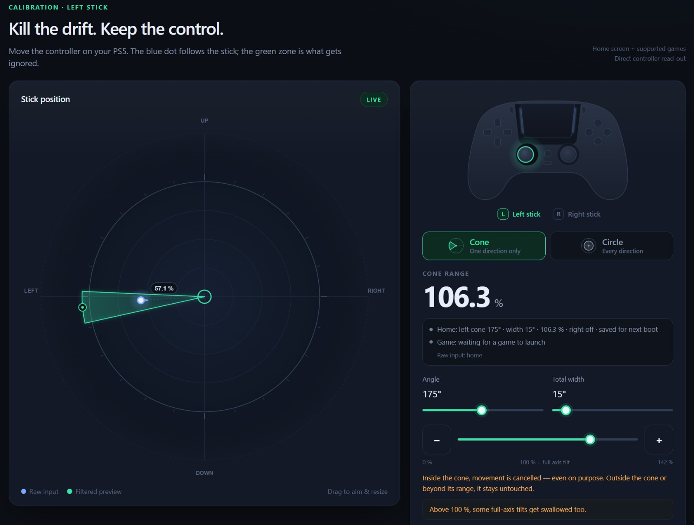

# ps5-dualsense-deadzone

An in-memory deadzone filter for the sticks of a DualSense on a jailbroken
PlayStation 5, for controllers that drift in one direction.

A classic circular deadzone eats a bit of every direction. This payload aims a
**cone** at the drift instead: only movements inside the cone, up to the chosen
range, snap back to center. Everything else passes through untouched. A circle
mode is one tap away.

Everything runs on the console. The payload hooks the controller library of the
home screen and of the running game, and you calibrate from a browser on your
phone or computer, with a live view of the raw stick position.



## Download

Grab `ps5-dualsense-deadzone.elf` from the
[Releases](https://github.com/Iziman127/ps5-dualsense-deadzone/releases/latest)
page.

## Quick start

With an ELF loader such as [elfldr][elfldr] running on the console:

```console
$ export PS5_HOST=ps5
$ curl -m 30 --data-binary @ps5-dualsense-deadzone.elf http://$PS5_HOST:9021/
```

Then open `http://$PS5_HOST:8089/` in a browser. The badge top-right goes from
`CONNECTING…` to `LIVE` once a controller is on.

## Features

- Live read-out of the raw position of either stick, straight from the
  controller library.
- Cone deadzone (angle, width, range) or circle, set independently for the left
  and right stick. Range 0 % leaves a stick untouched.
- Applies to the home screen and follows into the running game automatically.
- Remembers the setting in `/data/ps5-dualsense-deadzone.conf` and restores it
  when the payload is loaded again.
- Self-contained web UI, no external resources. The only file written on the
  console is the saved setting, removed by Disable or Quit.

## Usage

Keep the PS5 on the home screen while calibrating: an app in the foreground
takes the controller away from the home screen, and the read-out follows it.
Calibrate with only the drifting controller on.

1. **Rest the stick.** The dot shows where the stick really is: that is your
   drift, direction and strength.
2. **Pick a shape.** Cone targets only the drifting side: aim with the radar or
   the angle slider, then tune the width. Circle neutralizes all directions
   equally.
3. **Set the range** by dragging on the radar, with the buttons, the arrow keys
   or the mouse wheel. Past 100 %, full tilts start getting swallowed too, and
   the UI warns you.
4. **Apply.** The status line shows the home screen state and, once a game
   runs, the game state.
5. **Launch your game.** If its controller library matches, the game line
   switches to your setting. Otherwise it says why and nothing is patched.

The two dots on the radar: the plain dot is the raw stick, the ringed dot is
the preview of your draft, at center when neutralized.

**Disable filter** restores the original controller reads and clears the saved
setting; the payload keeps running. **Quit** does the same and stops the
payload, freeing port 8089.

## Payload Manager and autostart

The Payload Manager daemon (port 8084) accepts uploads and launches:

```console
$ curl -X POST "http://$PS5_HOST:8084/manage:upload?filename=ps5-dualsense-deadzone.elf" \
    -H "Content-Type: application/octet-stream" --data-binary @ps5-dualsense-deadzone.elf
$ curl "http://$PS5_HOST:8084/loadpayload:/data/pldmgr/payloads/ps5-dualsense-deadzone/ps5-dualsense-deadzone.elf"
```

A reboot clears the patched memory, but the saved setting survives and is
reapplied when the payload loads again. To load it at every boot, add it to
Payload Manager's Auto Start list, after your jailbreak chain and with a few
seconds of delay: it needs the kernel to be up.

Uploading stores the ELF on the console, under `/data/pldmgr/payloads/`. It
stays there until you delete it from Payload Manager. Sending the ELF to
elfldr instead loads it in memory only.

To update, press Quit on the running payload, then upload and launch the new
one. Two instances cannot share port 8089.

## Compatibility

Tested on firmware 10.20. Other firmwares are not tested: expect a clean
refusal (with the reason in the UI) rather than a broken patch.

- **Layout discovery**: the five controller-reader functions are resolved by
  name inside the target process (`kernel_dynlib_dlsym`) and cross-checked
  against the actual library code (paired reader thunks). The two reader
  entries the home screen imports are additionally pinned by their instruction
  bytes, and every imported-reader pointer is found by scanning memory. An
  unexpected layout — a different firmware build of the controller library —
  is refused cleanly, never patched blind.
- **Filter code area**: the payload locates a
  previous install by signature and claims the longest unused (all-zero) gap
  of the executable image, verified empty before use.
- **Games**: a native PS5 game is hooked when its controller library resolves
  the same named functions and shows the expected structure. Otherwise it is
  left untouched and the UI says so.

## Known issues

- **A game does not load with the filter on** (black screen or endless loading
  after launching it from the home screen): press **Disable filter**, launch
  the game, and once you are in game press **Apply** again. The filter then
  follows that game for the rest of the session.
- One setting for all controllers: every packet passing through a hook gets the
  same deadzone.
- The filter hides the drift, it does not repair the worn potentiometer.
- The web UI is reachable by anyone on your LAN. There is no authentication.

## Building

Install the [PS5 payload SDK][sdk], LLVM 18, Python 3 and Node.js, then:

```console
$ export PS5_PAYLOAD_SDK=/opt/ps5-payload-sdk
$ export LLVM_CONFIG=/usr/lib/llvm-18/bin/llvm-config
$ make
```

The output is `ps5-dualsense-deadzone.elf`. Every build starts from a fresh
`build/payload-*` directory, where the assembly stubs are assembled and the web
UI is embedded, and leaves a record with the hashes of the sources and of the
SDK files used. The UI shows the build id reported by `/api/state`.

`make test` runs the host checks: the generated assembly against a C model over
every byte-coordinate pair, the UI preview against the same model, the patch
functions with injected write failures to check rollback, the HTTP checks, the
input sampling and the saved-setting file. `make deploy PS5_HOST=ps5` sends the
ELF to the loader.

These checks validate the logic, not the console. Test a new build on the PS5
before relying on it.

## How it works

The payload finds the controller read functions imported by the home screen,
checks their bytes, and redirects them to a small assembly stub placed in an
unused code area. The stub zeroes the stick coordinates when they fall inside
the configured cone. For games, the same stub is placed in the game's own copy
of the library once its code matches a fixed fingerprint. The game is never
stopped while it is patched.

Details and diagrams: [docs/HOW-IT-WORKS.md](docs/HOW-IT-WORKS.md)

## Reporting bugs

If you run into a problem, please [file an issue][issues] with the exact error
text and the `/api/state` output. Please do not attach memory dumps.

## Credits

- [ps5-payload-dev/sdk][sdk] and [elfldr][elfldr], for the toolchain and the
  loader this payload is built for.
- PS5 Payload Manager, for storing and autostarting payloads on the console.

## License

ps5-dualsense-deadzone is licensed under the GPLv3+. See [LICENSE](LICENSE).

## Disclaimer

Hobbyist homebrew for a jailbroken console, provided as is, without warranty of
any kind. Not affiliated with or endorsed by Sony Interactive Entertainment.

[sdk]: https://github.com/ps5-payload-dev/sdk
[elfldr]: https://github.com/ps5-payload-dev/elfldr
[issues]: https://github.com/Iziman127/ps5-dualsense-deadzone/issues/new
